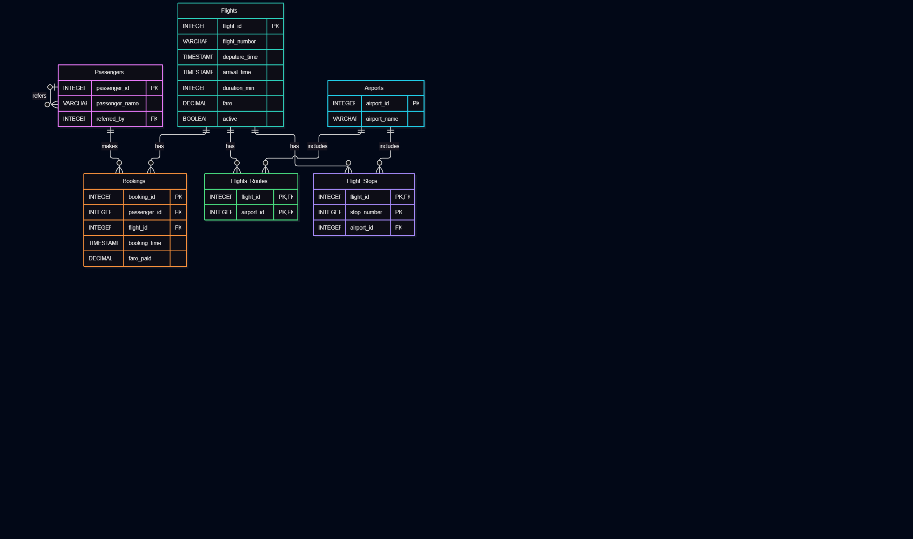

## Project title: Airline_Booking_Database
Relational database course project for an airline booking system.

## Theme
Airline Booking System

## Domain
The Airline Booking System is a platform designed to organize and manage information about passengers, flights, bookings, airports, and flight routes. Passengers can make bookings for available flights, and each booking connects a passenger with a specific flight. The system also keeps information about airports and connects flights to airports through flight routes.

The database should be able to answer important questions about the airline booking process. For example, it should identify which flights a passenger has booked, which passengers are booked on a particular flight, and which airports are associated with a flight. It should also provide flight information such as the flight number, departure time, arrival time, fare, and whether the flight is active. Organizing this information in a relational database helps keep the data accurate, consistent, and easy to retrieve.

## Entity Relationship Diagram 
The following ERD shows the relationships between the main entities in the Airline Booking Database.
 

## Schema

For Assignment 2, I converted my Airline Booking Database ERD into PostgreSQL tables. The database contains six tables: passengers, flights, airports, bookings, flight_routes, and flight_stops.

I added primary keys and foreign keys to connect the tables and maintain relationships between the data. I also used CHECK constraints to prevent invalid values, such as negative flight fares and incorrect arrival times.

The passengers table includes a recursive foreign key to track passenger referrals. The flights table includes a derived attribute called duration_min, which calculates flight duration from departure and arrival times.

The flight_stops table represents a weak entity because each stop belongs to a specific flight. The flight_routes table resolves the many-to-many relationship between flights and airports.

I tested the SQL schema in PostgreSQL 16 using pgAdmin 4 and verified that all six tables were created successfully.

**Schema SQL file:** [schema.sql](schema/schema.sql)

**Constraint analysis:** [Unit 2 Analysis](analysis/unit2.md)

**ERD:** [Airline Booking ERD](schema/erd1.png)

## Unit 4: From Rows to Insight

In Unit 4, I used SQL aggregation to analyze booking activity and identify booking failures across flights and regions.

### Query Catalog

**queries/unit4/q4_1.sql — Basic Aggregation**

This query file answers the following business questions:
- How many total bookings and unique passengers are there?
- What are the total, average, minimum, and maximum fares?
- Which flights have the most bookings?
- Which flights have at least 10 bookings?
- How do booking totals differ by country and flight?

**queries/unit4/q4_2.sql — Advanced Aggregation**

This query file answers the following business questions:
- How many total and failed bookings does each flight have?
- How many bookings and failures occurred in each country?
- What are the overall booking and failure totals?
- What is the baseline failure rate for flights with at least 10 bookings?

### Key Finding

The dataset contains 200 bookings, including 44 cancelled or disputed bookings, giving an overall failure rate of 22%. Flight IDs 3, 9, and 11 were identified for further investigation.
